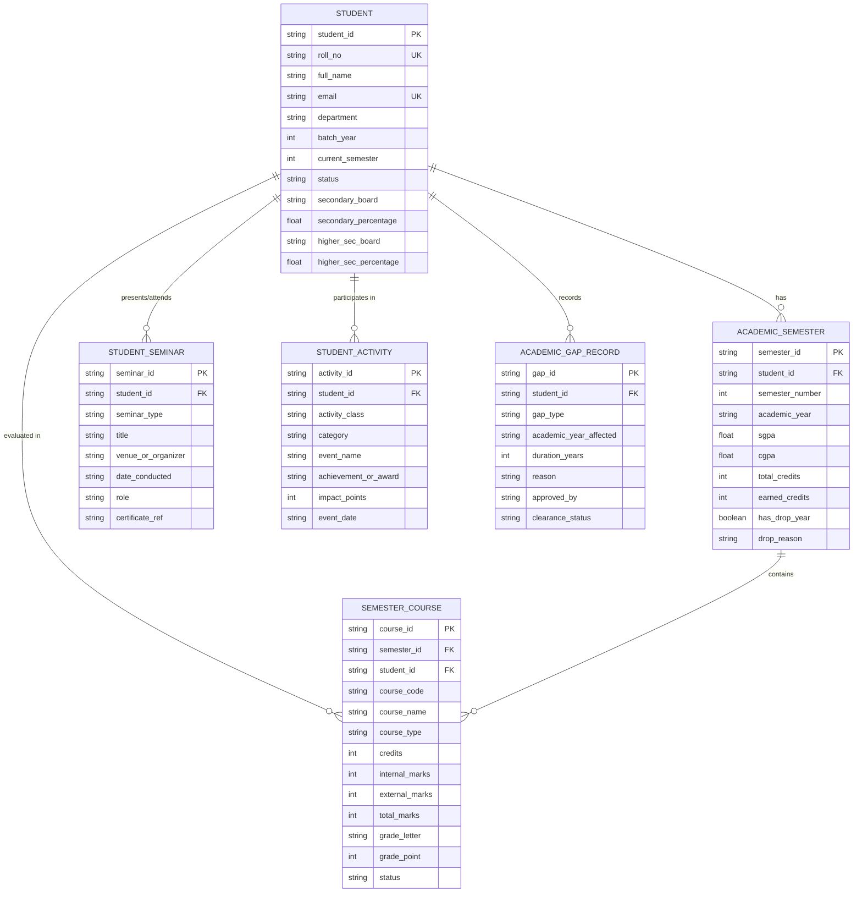

# 🎓 ScholarPulse: Student Academic & Portfolio Progression DBMS

[](https://share.streamlit.io/)
[](https://react.dev/)
[](https://www.typescriptlang.org/)
[](https://vitejs.dev/)
[](https://tailwindcss.com/)
[](#relational-database-schema--3nf-architecture)

> **ScholarPulse** is an institutional-grade **Relational Database Management System (DBMS)** designed to track student academic trajectories from pre-admission baselines (10th & 12th boards) to graduation, governing academic drop years, dual-component mark evaluation (Internal /40 + External /60), and segregated co-curricular portfolios with Google Sheets & Excel synchronization.

---

## 🌟 Key Features

### 1. 📊 Normalized 3NF Relational Data Architecture
- Strictly adheres to **Third Normal Form (3NF)** with explicit primary and foreign key constraints.
- **Cascade Deletion**: Removing a student cascades through their enrolled semesters, evaluated theory/lab marks, seminars, co-curricular achievements, and gap records.
- Comprehensive seed dataset containing **105+ realistic student records** across multiple engineering disciplines (*Computer Science, Information Technology, AI & Data Science, Electronics & Communication, and Mechanical Engineering*).

### 2. 📝 Dual-Component Academic Evaluation Engine
- Standard university assessment model:
  - **Internal Assessment (Continuous Evaluation)**: 0 to 40 Marks
  - **End-Semester Examination**: 0 to 60 Marks
  - **Total Composite Marks**: 0 to 100 Marks
- Automatic calculation of **Grade Letter** and **Grade Points (10-point scale)**:
  - `90 - 100` ➔ **O** (Outstanding, 10 pts)
  - `80 - 89` ➔ **E** (Excellent, 9 pts)
  - `70 - 79` ➔ **A** (Very Good, 8 pts)
  - `60 - 69` ➔ **B** (Good, 7 pts)
  - `50 - 59` ➔ **C** (Fair, 6 pts)
  - `40 - 49` ➔ **D** (Pass, 5 pts)
  - `< 40` ➔ **F** (Fail / Backlog, 0 pts)
- Dynamic calculation of **Semester SGPA** and cumulative **CGPA** weighted by course credits.

### 3. ⚠️ Academic Drop Year & Gap Governance
- Specialized relational tracking for academic interruptions (*Mid-Course Drop Year, Pre-College Gap, Medical Leave, Semester Repeat*).
- Stores approving authorities, official medical board clearance, affected academic years, and reason documentation.
- Visual alerts and clearance indicators on student transcripts.

### 4. 🏆 Segregated Multi-Tiered Portfolios
- **Technical Co-Curricular Portfolio**: Seminars (Internal Colloquiums vs External National/International Conferences), Hackathons (e.g., Smart India Hackathon), Coding Competitions (ACM ICPC), Research Paper Presentations, and Technical Workshops.
- **Extra-Curricular Portfolio**: Inter-university athletics, cultural arts, and NSS social outreach.
- **Impact Scoring System**: Assigns quantified points based on achievement tier (*1st Place, Runner Up, Consolation, Participation, Lead Organizer*).

### 5. 🔄 Bidirectional Data Parity & Export
- **Google Sheets Synchronizer**: Continuous 1-way parity integration via Google Apps Script Web App endpoints.
- **Excel (.xlsx) Multi-Sheet Workbooks**: Export individual transcripts or entire relational schema snapshots into organized sheets.
- **CSV Data Exports**: Quick student directory and semester marksheet downloads.

---

## 🗄️ Relational Database Schema & 3NF Architecture



---

## 🚀 Dual Deployment: Streamlit & React Web App

This project can be run and deployed in two complementary modes:

### Mode A: Python Streamlit Application (`app.py`)
Perfect for instant cloud publishing on **Streamlit Community Cloud**, Google Cloud, or local Python environments.

#### 1. Install Dependencies
```bash
pip install -r requirements.txt
```

#### 2. Run Streamlit
```bash
streamlit run app.py
```
The application will launch automatically in your browser at `http://localhost:8501`.

---

### Mode B: React 19 + TypeScript + Vite Web App
The full-featured single-page application with modern UI components, animations, and Firebase integration.

#### 1. Install Node Dependencies
```bash
npm install
# or
bun install
```

#### 2. Start the Dev Server
```bash
npm run dev
# or
bun dev
```
The web app will run locally at `http://localhost:3000`.

---

## ☁️ Publishing on Streamlit Community Cloud

Follow these steps to deploy the application on [Streamlit Community Cloud](https://share.streamlit.io):

1. **Push your code to GitHub**:
   Ensure this repository (`Pravjn/Student_MP`) is updated on GitHub.
2. **Open Streamlit Community Cloud**:
   Visit [share.streamlit.io](https://share.streamlit.io) and sign in with your GitHub account.
3. **Create New App**:
   - **Repository**: `Pravjn/Student_MP`
   - **Branch**: `main`
   - **Main file path**: `app.py`
4. **Deploy**:
   Click **Deploy!** Streamlit Cloud will automatically detect `requirements.txt`, install dependencies, and launch your live URL.

---

## 📁 Repository Structure

```
Student_MP/
├── app.py                      # Streamlit Application (Academic DBMS & Analytics Dashboard)
├── requirements.txt            # Python dependencies for Streamlit Cloud deployment
├── package.json                # React 19 & Vite dependencies
├── vite.config.ts              # Vite configuration
├── tsconfig.json               # TypeScript configuration
├── index.html                  # HTML5 entrypoint
├── metadata.json               # Project metadata & capabilities
├── firebase-applet-config.json # Firebase configuration
├── src/
│   ├── App.tsx                 # Master React application component
│   ├── main.tsx                # React DOM entrypoint
│   ├── index.css               # Global Tailwind CSS styles
│   ├── types/
│   │   └── schema.ts           # 3NF Relational DBMS TypeScript interfaces
│   ├── db/
│   │   ├── relationalStore.ts  # In-memory relational database & subscription layer
│   │   ├── calculations.ts     # SGPA, CGPA & 10-point scale grading logic
│   │   ├── validation.ts       # Relational integrity & schema constraint validators
│   │   ├── seedData.ts         # 105+ Student profiles, courses, seminars & activities
│   │   └── db.test.ts          # Unit tests for calculations and data integrity
│   ├── services/
│   │   ├── googleSheetsService.ts # Google Sheets API parity handler
│   │   ├── appsScriptTemplate.ts  # Apps Script web app webhook template
│   │   ├── excelService.ts        # Excel (.xlsx) multi-sheet workbook generator
│   │   └── firebaseAuth.ts        # Firebase Authentication service
│   └── components/
│       ├── Header.tsx                 # Navigation & master actions
│       ├── StudentSelector.tsx        # Searchable student directory selector
│       ├── StudentProfileBanner.tsx   # Student metadata & secondary/higher sec stats
│       ├── SemesterGradesView.tsx     # Semester progression & marks matrix
│       ├── PortfoliosView.tsx         # Segregated co-curricular & extra-curricular hub
│       ├── AnalyticsOverview.tsx      # High-level institute analytics
│       ├── AcademicMilestoneTimeline.tsx # Milestone progression timeline
│       ├── PerformanceComparisonChart.tsx# Visual performance charts
│       ├── PortfolioDistributionVisual.tsx# Category distribution visualizer
│       ├── SyncPipelineDiagram.tsx    # Live pipeline sync status diagram
│       ├── StudentModal.tsx           # Add/edit student modal
│       ├── CourseModal.tsx            # Add/edit course & marks modal
│       ├── SeminarModal.tsx           # Add/edit seminar record modal
│       ├── ActivityModal.tsx          # Add/edit activity record modal
│       ├── GapModal.tsx               # Academic gap record modal
│       ├── SyncManagerModal.tsx       # Spreadsheet synchronization manager
│       ├── ConnectSheetModal.tsx      # Google Sheets connection setup
│       └── DocumentationModal.tsx     # 3NF architecture & user manual modal
└── README.md                   # Comprehensive project documentation
```

---

## 🛠️ Technology Stack

| Domain | Technology / Library | Version | Purpose |
| :--- | :--- | :--- | :--- |
| **Python Cloud App** | `Streamlit` | `^1.35.0` | Cloud-hosted dashboard & interactive DBMS interface |
| **Data Science** | `Pandas`, `Plotly`, `OpenPyXL` | Latest | Analytics, interactive charts, and Excel exports |
| **Frontend Framework** | `React` | `19.0.1` | Reactive component-driven user interface |
| **Language** | `TypeScript` | `7.0.2` | Type safety and strict relational schema models |
| **Build Tool** | `Vite` | `8.3.0` | Ultra-fast local development server & bundling |
| **Styling** | `Tailwind CSS` | `4.3.3` | Modern responsive styling & glassmorphic aesthetics |
| **Authentication** | `Firebase Auth` | `13.1.0` | User authentication and session management |
| **Spreadsheet Sync** | `XLSX (SheetJS)` & `Google Apps Script` | `0.18.5` | Multi-sheet Excel workbook generator & live Google Sheets sync |

---

## 📜 Academic DBMS Project Compliance
- **1NF**: Atomic values for all attributes; multi-valued fields normalized into distinct relation tables (`StudentSeminar`, `StudentActivity`, `SemesterCourse`).
- **2NF**: No partial functional dependencies; all non-prime attributes fully functionally dependent on whole composite primary keys.
- **3NF**: No transitive dependencies; non-prime attributes depend strictly on candidate keys (`student_id`, `semester_id`, `course_id`).
- **Integrity Constraints**: `ON DELETE CASCADE` ensures foreign key referential consistency across all child tables.

---

## 👨‍💻 Author & Repository

- **Repository**: [https://github.com/Pravjn/Student_MP](https://github.com/Pravjn/Student_MP)
- **Author**: Praveen Tiwari ([@Pravjn](https://github.com/Pravjn))
